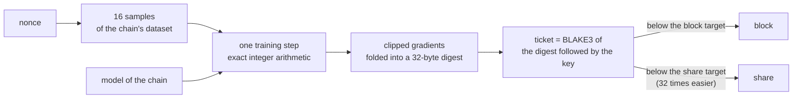
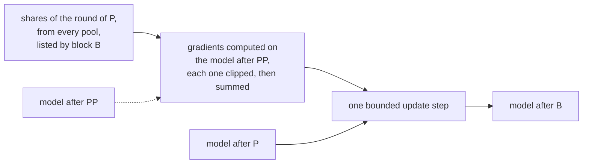

# NEB

NEB (Neural Engine Byte) is a proof-of-work cryptocurrency where mining trains a neural network. Every mining attempt is one training step of a small network that the chain owns, computed in exact integer arithmetic. The chain trains two 784-128-10 classifiers with 4-bit weights on public scientific data, one block each in turn: transit signals of the Kepler mission (NASA Exoplanet Archive), sorted into planet candidates and false positives, and retinal OCT scans (OCTMNIST), sorted into three diseases and normal. A node checks a block by running its attempts again, about 0.5 ms of one CPU core per attempt, with no zero-knowledge proof and no trusted party.

[Whitepaper](docs/whitepaper.md) | [Specification](spec/shares.md) | [Node and chain](spec/node.md) | [Network guide](docs/testnet.md) | [Docker](docs/docker.md) | [Mining engines](docs/mining.md) | [Experiments](docs/experiments.md)

## NEB at a glance

**One mining attempt**



**How the model evolves, one block later**



NEB's innovation lies in the protocol-level integration of deterministic neural network training with proof of work: the training step is the mining proof, and the shares that nodes validate train a model that the chain owns.

- **Nothing to choose.** The chain fixes the dataset and the model; the miner chooses only the nonce.
- **Training without extra work.** Shares come from the same attempts as blocks.
- **Verification by replay.** Every node rebuilds the model from the shares listed in the blocks. There is no proof system to trust.
- **Bounded influence.** Clipping and a bounded residual limit what one share can do to one step (Theorem 1 of the whitepaper).

| | |
|---|---|
| Network | 784-128-10, 4-bit weights, 101,632 weights |
| One attempt | 16 samples, one training step, about 3.3 million integer multiply-accumulates |
| Shares | about 32 per block, applied one block later |
| Block time | 60 s target, ASERT (aserti3-2d) with a 600 s half-life |
| Supply | 20 NEB per block, halving every 450,000 blocks, no premine; 5 % project share in the coinbase |
| Money layer | UTXO, Ed25519 signatures, BLAKE3, no virtual machine |
| Verification | about 0.5 ms of one CPU core per attempt, 17 ms for a typical block |

In simulation of the protocol, the Kepler model reaches 88.8 % on stars it never trained on (a float network of the same shape trained with Adam: 89.0 %), and the retina model 55 % on four balanced classes after 12,000 blocks. From block 8800 both models are small convolutional networks ([spec/nebhash-v2.md](spec/nebhash-v2.md)): in simulation, 90.8 % for Kepler and 81 to 83 % for the retina on a normal or abnormal task (500 balanced test scans). Earlier measurements on MNIST: 96.0 % test accuracy in simulation, and on the node software 10 pools train the model as well as one (89.9 % after 300 blocks).

## Status

Version 0.3.0 runs a test network: protocol 3, genesis `8271952aba2a...` (full id and parameters in [docs/testnet.md](docs/testnet.md)). Its coins have no value. By default a node dials the two public relays `seed1.neuralenginebyte.org` and `seed2.neuralenginebyte.org` (port 3440); `--no-seeds` keeps it alone, and `--connect` and `--seed` choose other peers.

## Quick start

### From a release

Download from the release page the archive for your system, `neb-datasets.bin` (the four datasets, 260 MB, pinned by hash; `neb-datasets.zip` is the same file compressed, 26 MB) and `SHA256SUMS`, and check them as described in "Releases". On Windows, in PowerShell:

```powershell
Expand-Archive neb-0.3.0-windows-x86_64.zip neb; Move-Item neb-datasets.bin neb; cd neb
.\neb-wallet.exe --wallet wallet.txt new         # asks for a password, prints your address; keep a copy of wallet.txt and of the password
$lock = .\neb-wallet.exe --wallet wallet.txt lock
.\neb-node.exe --run --dataset neb-datasets.bin --datadir data --miner-lock $lock
```

In a second window:

```powershell
.\neb-miner-cpu.exe --node 127.0.0.1:3441 --dataset neb-datasets.bin    # or neb-miner-gpu.exe on an NVIDIA GPU
.\neb-wallet.exe --rpc http://127.0.0.1:8432 --wallet wallet.txt balance
```

On Linux:

```bash
mkdir neb && tar -xzf neb-0.3.0-linux-x86_64.tar.gz -C neb && mv neb-datasets.bin neb && cd neb
./neb-wallet --wallet wallet.txt new
./neb-node --run --dataset neb-datasets.bin --datadir data --miner-lock "$(./neb-wallet --wallet wallet.txt lock)" &
./neb-miner-cpu --node 127.0.0.1:3441 --dataset neb-datasets.bin    # or neb-miner-gpu
```

Mined coins are spendable after 100 blocks. The GPU miner needs an NVIDIA GPU of compute capability 7.5 or later and a driver for CUDA 13 (580 or later).

### With Docker

```bash
export NEB_MINER_ADDRESS=neb1...      # the address printed by neb-wallet new
docker compose up -d
docker compose logs -f node miner
```

The images hold no key, only the address that receives the rewards. GPU and relay setups: [docs/docker.md](docs/docker.md).

### From source

Requirements: Rust, a C compiler, and Python 3 with numpy for the dataset tool.

```bash
git clone https://github.com/SilasEigen/neb.git && cd neb
(cd node && cargo build --release --locked)                 # neb-node, neb-wallet, neb-miner-cpu
python tools/make_datasets.py --cache ../neb-cache --out ../neb-datasets.bin   # or take neb-datasets.bin from the release
node/target/release/neb-node --dataset-hash ../neb-datasets.bin # b1008b970f87083179a7b297b8f0fbec4cfc8cc66f605cf2fb2c03bad8b6f37a
```

`cargo build --release --locked -p neb-gpuminer --features cuda` adds `neb-miner-gpu` (CUDA toolkit 13). The miners can also use optional AVX-512 and tensor-core engines, off by default and checked against the reference: see [docs/mining.md](docs/mining.md). Node options, ports and wallet commands are in [docs/testnet.md](docs/testnet.md).

## Documentation

| Document | Contents |
|---|---|
| [docs/whitepaper.md](docs/whitepaper.md) | Design, security model and main results |
| [spec/shares.md](spec/shares.md) | Normative: the attempt, the ticket, shares and the model step |
| [spec/node.md](spec/node.md) | Normative: blocks, transactions, chain rules, work service, P2P, JSON-RPC |
| [docs/testnet.md](docs/testnet.md) | Network parameters, genesis, running a node, a relay and the miners |
| [docs/mining.md](docs/mining.md) | Optional mining engines and their safeguards |
| [docs/experiments.md](docs/experiments.md) | Simulations, measurements, validation and throughput, with methods |
| [CONTRIBUTING.md](CONTRIBUTING.md) | Repository layout, checks to run and contribution rules |

## Releases

Release archives contain `neb-node`, `neb-wallet`, `neb-miner-cpu` and `neb-miner-gpu`. Each release has a `SHA256SUMS` file signed with the release key (`SHA256SUMS.asc`) and a detached signature for each archive (`.sig`). The public key is the release asset `release-key.asc`, fingerprint `EBF3 A9A0 37BC D121 0464  2A30 D7FC 5241 9E25 BBC4`.

```bash
gpg --import release-key.asc
gpg --verify SHA256SUMS.asc SHA256SUMS
sha256sum -c SHA256SUMS
```

On Windows, in PowerShell, compare these hashes with the lines of `SHA256SUMS` (Gpg4win verifies the signature):

```powershell
Get-FileHash -Algorithm SHA256 neb-0.3.0-windows-x86_64.zip, neb-datasets.bin
```

Changes are listed in [CHANGELOG.md](CHANGELOG.md).

## License

Apache-2.0, see [LICENSE](LICENSE). Security reports: [SECURITY.md](SECURITY.md).
